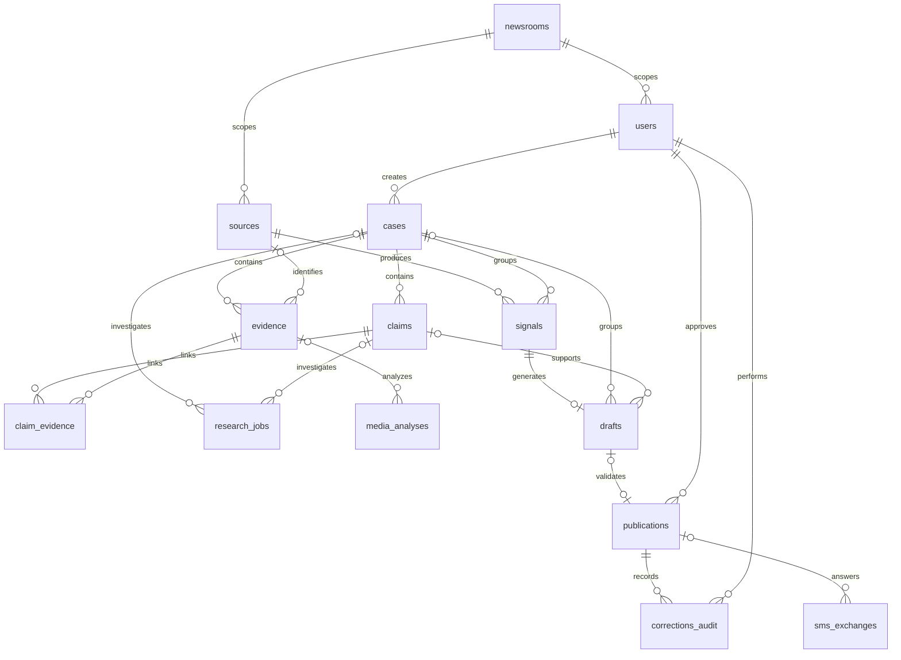

# Persistance FA AI MARINANA

Les règles actuelles d’inscription, de session et de publication sont décrites dans [AUTHENTICATION.md](AUTHENTICATION.md).

Cette livraison implémente les treize entités demandées, les contraintes de rédaction/jeu de données et une frontière de lecture publique. Elle conserve les noms de champs historiques utilisés par les schémas HTTP ; les noms de tables sont désormais canoniques en anglais.

## Modèles livrés

| Table | Classe SQLAlchemy | Fichier | Rôle et statuts |
|---|---|---|---|
| users | User, alias Utilisateur | [identity.py](app/models/identity.py) | Comptes, six rôles RBAC ; active, suspended, archived |
| sources | Source, alias SourceSurveillee | [monitoring.py](app/models/monitoring.py) | Sources privées ; Actif, Inactif |
| signals | Signal, alias SignalBrut | [monitoring.py](app/models/monitoring.py) | Signaux originaux privés ; new, triaged, investigating, archived |
| cases | Case | [investigation.py](app/models/investigation.py) | Dossiers ; open, investigating, review, closed, archived |
| claims | Claim | [investigation.py](app/models/investigation.py) | Affirmations et verdicts ; unverified, investigating, verified, disputed, insufficient |
| evidence | Evidence | [investigation.py](app/models/investigation.py) | Preuves ; collected, reviewing, verified, rejected |
| claim_evidence | ClaimEvidence | [investigation.py](app/models/investigation.py) | Association documentée ; proposed, reviewed, rejected ; supports/refutes/context |
| research_jobs | ResearchJob, alias RechercheMaharavo | [maharavo.py](app/models/maharavo.py) | Recherches privées ; queued, en_cours, terminee, partielle, echouee, cancelled |
| media_analyses | MediaAnalysis, alias AnalyseMediaMaharavo | [maharavo.py](app/models/maharavo.py) | Analyses privées ; pending, running, completed, failed, reviewed |
| drafts | Draft, alias DraftIA | [editorial.py](app/models/editorial.py) | Brouillons privés ; En_Attente, En_Cours, Rejete |
| publications | Publication, alias ArticleCertifie | [editorial.py](app/models/editorial.py) | Copie des seuls contenus approuvés ; scheduled, published, withdrawn, archived |
| corrections_audit | CorrectionAudit | [audit.py](app/models/audit.py) | Journal privé et immuable ; recorded ; published/corrected/withdrawn/restored |
| sms_exchanges | SmsExchange, alias HistoriqueSms | [sms.py](app/models/sms.py) | Échanges privés ; Trouve/Non_Trouve/Pending/Failed et état de livraison distinct |

La table supplémentaire [newsrooms](app/models/newsroom.py) constitue le registre des rédactions. Les cinq tables auxiliaires existantes — contacts_journalistes, documents_recherche, sessions_chat, messages_chat, evaluations_confiance_maharavo — sont conservées et reçoivent le même cloisonnement. Ces dix-neuf tables de persistance sont complétées par cinq tables d’authentification/administration de la migration 0003, soit vingt-quatre tables en plus d’alembic_version.

Chaque entité principale possède `id`, `created_at`, `updated_at`, `newsroom_id`, `dataset` et `confidentiality`. Les définitions communes sont dans [common.py](app/models/common.py). PostgreSQL actualise `updated_at` par trigger, y compris pour les UPDATE SQL directs ; SQLAlchemy gère aussi les dates des écritures ORM. Les dates utilisent TIMESTAMPTZ sur PostgreSQL.

## Relations et intégrité



Les relations SQLAlchemy utilisent `relationship` et `back_populates` lorsque les deux directions sont utiles. Les collections ne suppriment pas silencieusement leurs enfants : les clés étrangères RESTRICT préservent les dossiers, preuves et traces déjà référencés.

Les clés étrangères métier incluent systématiquement `(newsroom_id, dataset)`. L'association claim_evidence et les liens vers une affirmation ou une preuve incluent aussi `case_id`. La base refuse ainsi un lien entre rédactions, jeux de données ou dossiers incompatibles, même si une insertion SQL contourne l'ORM.

Les contraintes couvrent notamment les valeurs de statut et de confidentialité, les bornes des scores, la fréquence de scan, les interactions positives, les dates de recherche, la révision positive, l'unicité d'un brouillon par signal, d'une publication par brouillon, d'une paire affirmation/preuve et d'une empreinte de preuve dans son périmètre. PostgreSQL vérifie aussi le format hexadécimal SHA-256. Les index couvrent le périmètre/date, les clés étrangères utilisées dans les recherches, les états de workflow, les urgences et les publications publiques.

## Frontière privé/public

1. Les tables privées n'acceptent que `private` ou `confidential` par contraintes SQL. Une preuve ou une analyse IA ne peut pas devenir publique par un simple changement de drapeau.
2. Une publication est une copie explicite du titre, corps, catégorie, verdict et résumé SMS validés. Elle ne publie pas l'objet Draft ni ses citations et preuves.
3. Les vues `public_publications` et `demo_publications` ne sélectionnent que les champs publics autorisés, plus l'identifiant de rédaction nécessaire au filtrage serveur. Aucun hash de mot de passe, numéro de téléphone, source confidentielle, draft_id, preuve ou résultat IA n'y figure.
4. Une vue ne retourne que les lignes `confidentiality=public`, `status=published`, disposant d'une date de publication non future et d'un verdict valide. La première sert uniquement `dataset=real`, la seconde uniquement `dataset=demo`. Les archives en quarantaine n'ont aucune vue publique.
5. `/api/public/articles`, son alias v1 et les recherches de réponses SMS utilisent exclusivement [PublicPublicationRepository](app/repositories/publications.py). Le schéma HTTP public reste une liste explicite de champs et n'expose pas newsroom_id.
6. La production exige `PUBLIC_DATABASE_URL` avec un compte distinct de celui des écritures. Les connexions publiques sont en lecture seule. Au démarrage, l'application vérifie que ce compte n'est pas superutilisateur, ne contourne pas RLS, n'a aucun droit sur les tables applicatives et peut lire la vue réelle. Elle refuse de démarrer sinon.
7. Les sessions privées exigent un [DataScope](app/database/scope.py). Les SELECT ORM, UPDATE/DELETE ORM et flush sont contrôlés. Les recherches d'identité sont une capacité interne distincte ; le client ne choisit jamais sa rédaction dans une requête.
8. Les alertes WebSocket sont cloisonnées par rédaction et dataset, comme les lectures HTTP.

Préparer le rôle PostgreSQL après les migrations avec [public_access.sql](database/public_access.sql), exécuté par l'opérateur dans la base voulue. Ce script ne stocke aucun mot de passe et n'attribue pas de droits sur la vue demo. Provisionner séparément une identité LOGIN, lui attribuer le rôle lecteur et conserver ses identifiants dans le gestionnaire de secrets. Les droits hérités sont aussi vérifiés au démarrage.

En développement, le moteur public peut réutiliser le moteur local si aucune URL distincte n'est fournie ; il reste limité aux vues par le repository. La séparation par privilèges PostgreSQL est obligatoire en production. Le compte applicatif et les sessions opérateur restent des identités de confiance : les gardes ORM ne sont pas présentés comme une politique RLS couvrant tout SQL arbitraire exécuté par ces comptes.

## Démonstration, réel et archives

`dataset` vaut `real`, `demo` ou `quarantine`. Chaque rédaction appartient à un seul dataset, imposé par une clé étrangère composite. Le jeu réel et le jeu fictif ne peuvent donc pas partager une rédaction par accident.

La migration crée la rédaction 1 pour les nouvelles données réelles et la rédaction 2 pour les archives non classifiées. Toutes les lignes historiques sont conservées, rattachées à la rédaction 2, marquées `quarantine` et privées. Aucun article historique n'est automatiquement considéré comme validé pour une remise en ligne. Les anciens comptes conservent l'accès privé à leurs archives après connexion, mais la publication depuis la quarantaine est refusée.

Une reclassification historique nécessite une migration de données revue, avec attribution réelle des rédactions, qualification réel/demo et nouvelle décision éditoriale pour la publication. Aucun script ne suppose ces informations manquantes.

Les flux publics utilisent `PUBLIC_NEWSROOM_ID` et `PUBLIC_DATASET` de la configuration serveur. Un paramètre d'URL `dataset=demo` ne permet pas d'accéder aux démonstrations. En production, le flux public est obligatoirement réel. Pour une démonstration, utiliser de préférence une base et une instance dédiées.

## Migrations

[0001_modular_baseline.py](alembic/versions/0001_modular_baseline.py) reste inchangée. [0002_investigation_storage.py](alembic/versions/0002_investigation_storage.py) fige le nouveau schéma et réalise :

- Précontrôle des publications dupliquées et validateurs inexistants, sans suppression automatique.
- Renommage des huit tables historiques concernées, en conservant leurs identifiants et données.
- Création des dossiers, affirmations, preuves, associations, audit et rédactions.
- Ajout et remplissage conservateur des métadonnées de confidentialité, rédaction, dataset et dates.
- Reconstruction des clés étrangères composites, unicités et contraintes ; création des index nécessaires.
- Création des vues publiques filtrées et des triggers de dates et d'immutabilité.

Depuis `Backend/`, sur une copie sauvegardée de la base :

```sh
alembic upgrade head
```

Si l'installation historique n'a aucune version Alembic :

```sh
alembic -x adopt_legacy=true upgrade head
```

La révision 0002 inspecte les données et s'exécute en ligne. Elle refuse la génération SQL hors connexion et le downgrade automatique, qui pourrait supprimer les preuves ou réexposer des archives. Un retour arrière requiert la restauration d'une sauvegarde revue. Aucun fichier SQL historique n'a été remplacé par cette livraison.

La migration PostgreSQL s'exécute dans une transaction. En cas de doublons ou de validateurs absents, elle s'arrête avant le renommage. Ne pas masquer cet échec avec un `stamp head`.

## CRUD et corrections

[Repository](app/repositories/base.py) fournit `get`, `list`, `add`, `update` et `delete`. Les [repositories d'investigation](app/repositories/investigations.py) spécialisent les nouveaux modèles. Ils ne font pas de commit : le service choisit la transaction. Les identifiants de rédaction, dataset et dates de création ne sont pas modifiables par le CRUD standard.

Exemple privé, après établissement de l'identité serveur :

```python
from app.database import SessionLocal
from app.database.scope import set_scope
from app.repositories import CaseRepository
from app.models import Case

with SessionLocal() as db:
    set_scope(db, newsroom_id=1, dataset="real")
    dossier = CaseRepository(db).add(Case(title="Investigation", created_by_id=approved_user_id))
    db.flush()
    CaseRepository(db).update(dossier.id, description="Description privée")
    db.commit()
```

L'identifiant de compte doit exister dans la même rédaction et le même dataset. En HTTP, le périmètre provient du compte authentifié ; il ne doit pas être construit à partir de paramètres libres du client.

La publication initiale crée un événement d'audit. [publications.py](app/services/publications.py) fournit aussi `correct_publication` et `withdraw_publication`, avec verrou, justification, révision, mise à jour de l'index et audit transactionnel. Une publication retirée disparaît immédiatement des vues publiques et du moteur SMS.

Le journal corrections_audit est volontairement append-only : création et lecture sont permises ; UPDATE, DELETE et TRUNCATE sont interdits. Les tests vérifient cette règle dans l'ORM et directement en SQL. Les opérations de suppression des autres entités sont testées dans l'ordre des dépendances ; supprimer un parent encore référencé est refusé.

Cette livraison ajoute la couche de persistance et les services ; elle ne crée pas de endpoints CRUD publics pour les dossiers ou les preuves.

## Données fictives et tests

[seed_demo.py](app/database/seed_demo.py) charge les treize entités dans une rédaction `fictional-demo`, exclusivement `dataset=demo`. Le chargement est idempotent. Les textes portent une mention fictive, les domaines utilisent `.invalid`, aucun numéro de téléphone réel n'est présent et aucun mot de passe exploitable n'est publié.

```sh
python -m app.database.seed_demo
```

Cette commande refuse l'environnement production. Elle n'est jamais exécutée automatiquement au démarrage.

Depuis `Backend/` :

```sh
python -B -m unittest discover -s app/tests -v
```

Les tests par défaut utilisent SQLite en mémoire. Pour vérifier PostgreSQL, fournir `FANILO_TEST_DATABASE_URL` vers une base strictement jetable et relancer la même commande : les tests y recréent les tables.

- [test_persistence.py](app/tests/test_persistence.py) : CRUD des douze entités mutables, création/lecture et immutabilité de l'audit, parcours des relations, contraintes de confidentialité, liens entre dossiers/datasets, cloisonnement, démonstrations et absence de fuite publique/SMS.
- [test_postgresql_migrations.py](app/tests/test_postgresql_migrations.py) : migration neuve et historique, conservation/quarantaine, refus des données incohérentes et permissions effectives d'un rôle lecteur PostgreSQL.
- [test_backend.py](app/tests/test_backend.py) : contrats historiques, authentification, workflow, WebSocket, sessions et concurrence.
- [test_migrations.py](app/tests/test_migrations.py) : cohérence ORM/migrations, adoption et garde-fous.

Les tests ne téléchargent pas de preuves réelles, n'appellent pas Gemini et n'envoient aucun SMS. Ils ne constituent pas un déploiement de production.

## Résultats de la phase de persistance (historique)

- PostgreSQL 17 temporaire : 34 tests réussis, sans test ignoré.
- SQLite en mémoire : 28 tests réussis ; 6 tests propres à PostgreSQL ignorés comme prévu.
- Vérifications réussies : syntaxe Python, cohérence des dépendances avec `pip check` et absence d'erreurs de diff avec `git diff --check`.
- Les tests PostgreSQL couvrent les migrations neuves et historiques, les droits du compte public, les clés étrangères composites, les corrections auditées et les publications concurrentes.
- Aucune migration ni donnée fictive n'a été appliquée à une base applicative existante ; seules les bases temporaires de test ont été utilisées.

## Mise à jour : historique des brouillons

La révision `0004_draft_history` ajoute `draft_revisions`, avec acteur, version,
événement et snapshot privé. Les clés étrangères composites conservent l'isolation
de rédaction/dataset ; les gardes SQL/ORM interdisent modification et suppression.
Les versions antérieures à l'installation ne sont pas inventées. Aucun changement
de colonne des tables existantes n'est requis par cette migration.

Les recherches asynchrones locales réutilisent `research_jobs` et ses états existants.
La synchronisation publique utilise un snapshot anonyme et des empreintes de contenu,
sans accès privé ni duplication de publications. Voir le
[guide d'intégration](../docs/INTEGRATION_TECHNIQUE.md).
